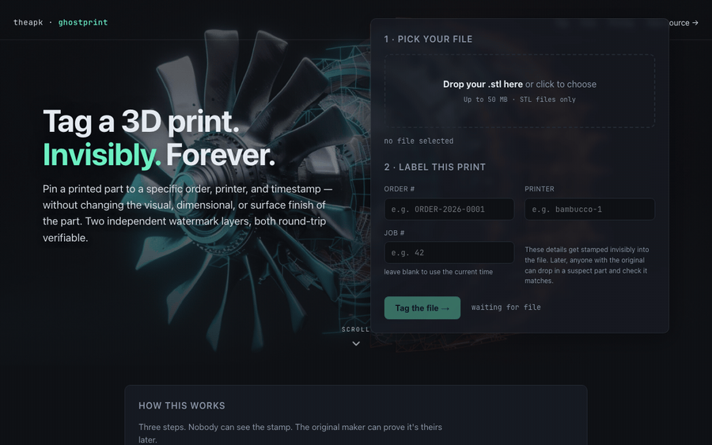

# ghostprint

> Two-layer invisible watermark for 3D-printed parts.
> Forensics, not DRM. Free for noncommercial use + hosted web version.

[](LICENSE)
[]()

---

## What it does

Once a 3D-print customer has the STL, you can't stop them from copying it forever. What you can do is prove the part they printed came from your STL.

ghostprint adds two independent invisible watermarks to your workflow:

- **Layer 1 — G-code watermark.** A 12-byte payload (printer + job + timestamp) encoded into sub-resolution Z-babysteps at the start of a sliced G-code file, duplicated in a `;` comment block. It lives in the G-code, not the STL. Recover it from a sliced file with `python verify-print.py decode-gcode <file.gcode>` (prints printer/job/timestamp JSON). Survives any slicer that doesn't strip comments.
- **Layer 2 — Geometric steganography.** Per-vertex perturbation whose amplitude the tagger picks inside the allowed ±0.005–0.020 mm range (default 0.012 mm), driven by a BLAKE2b hash of the order ID. Smaller than a typical 0.04 mm nozzle X/Y resolution. Translation-invariant. **Not** invariant under rotation or rescaling, and it does **not** survive re-meshing (standard slicers re-mesh).

Later, if a suspect part shows up, drop the original STL back in and ghostprint tells you whether it matches.

## Demo



*Above: the hosted drag-drop web flow — the server runs the same tagging code and produces both layers there. In the CLI, L1 lives in G-code, not the STL (see the real CLI outputs in Use).*

## Install

Not on PyPI yet. Install from the repo:

```bash
git clone https://github.com/theapk/ghostprint.git
cd ghostprint
python3 -m venv .venv
source .venv/bin/activate

pip install -r requirements.txt   # CLI scripts: tag-print.py, verify-print.py
# or, for the `ghostprint` console command:
pip install -e .
```

The `ghostprint` command exposes four verbs: `tag`, `verify`, `decode-gcode`, `self-test`.

## Use

```bash
# Tag an STL with order metadata
python tag-print.py master.stl \
  --order-id ORDER-2026-0001 \
  --printer bambucco-1 \
  --job-seq 42 \
  --out tagged.stl

# → writes tagged.stl + tagged.stl.manifest.json (plain JSON, unsigned —
#   bookkeeping only; the watermark itself is the proof).
#   L1 needs G-code: add --sliced-gcode your.gcode (splice into existing
#   slices) or --emit-gcode (standalone watermarked G-code).
#   `ghostprint tag` takes the same arguments.

# Later, verify a tagged part against its master (master first, tagged
# second — matching the original `ghostprint verify master.stl tagged.stl`
# promise; the sidecar manifest is auto-discovered next to the tagged part):
ghostprint verify master.stl tagged.stl
# … per-vertex diff report …
# → ✅ L2 match: order_id=ORDER-2026-0001 printer_id=15777188
#    printer_id is the 24-bit ID hashed from the printer name, supplied by
#    the sidecar manifest; no match line without it (pass --order-id instead).

# Recover the L1 layer from a G-code file — separate from STL verify,
# because L1 lives in the G-code, not the STL:
python verify-print.py decode-gcode tagged.gcode
# → {"printer_id": 15777188, "job_seq": 42, "ts_unix": 1795119073,
#    "ts_iso": "2026-11-19T20:11:13Z", "source": "comment"}
```

## Drag-drop web version

If you don't want to install Python, there's a hosted version:

**👉 https://ghostprint.theapk.com**

Three steps. No account required for the free tier. The web version uses the same CLI underneath — `tag-print.py` is the source of truth.

## Pricing (hosted version)

| Tier | Price | What you get |
|---|---|---|
| CLI | **Free** | Python, no upload, no tracking. Free for noncommercial use; commercial use requires a license. |
| Maker | $9/mo | Drag-drop web tool, hold master STLs in your account |
| Studio | $49/mo | Unlimited tags, multi-printer fleet dashboard, API access |

## Architecture

```
                   ┌──────────────────┐
   master.stl ───▶ │                  │
                   │   tag-print.py   │ ───▶ tagged.stl + <out>.manifest.json
   --order-id  ──▶ │                  │        (plain JSON, unsigned)
   --printer   ──▶ │                  │
   --job-seq   ──▶ │                  │
                   └──────────────────┘

   suspect.stl ─┐
                ├──▶ verify ───▶ ✅ / ❌ + extracted metadata
   master.stl ──┘
```

Both layers are written by `tag-print.py`. L1 needs G-code: give it `--sliced-gcode` (splice the watermark into existing slices) or `--emit-gcode` (standalone watermarked G-code); with neither, the L1 parameters are recorded in the manifest only. No network, no GPU. The L2 loop is pure Python — tagging a 50 MB STL takes ~1 min today; a vectorized fast path is planned.

## What it's not

- **Not DRM.** Can't stop someone from copying. Can't stop someone from stripping the watermark.
- **Not encryption.** Anyone with the original STL can extract the watermark. That's the point.
- **Not visible.** L2 perturbs vertices below typical print resolution; L1 rides inside the G-code text. Neither shows up on the part.

It's forensics. Think "document fingerprinting", not "encryption".

## Limitations

- L1 requires the G-code, not the STL. If the slicer strips `;` comments (very rare), only L2 survives.
- L2 is translation-invariant only. It does **not** survive rotation, rescaling, or re-meshing (standard slicers re-mesh — verify against the original master or a no-slicer path). Large temperature warp can shift vertices beyond the perturbation amplitude and break the match.
- No support for AMF, 3MF, or OBJ yet. PRs welcome.

## License

PolyForm Noncommercial 1.0.0 — free for personal, educational, and research use. Commercial use (selling the software, offering it as a paid service, using it in a commercial print farm) requires a separate license from theapk llc. See [LICENSE](LICENSE) for full terms.

## Author

Ian Schwartz — [@studiozeroseven](https://github.com/studiozeroseven) — [theapk llc](https://theapk.com)

---

**If you're selling 3D prints and want to catch knockoffs, this is for you.**
